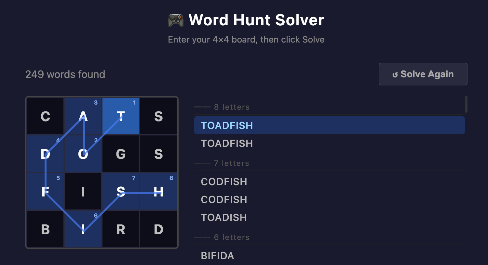

# Word Hunt Solver

A C++ solver for Word Hunt, the iMessage game similar to Boggle.

Given a 4×4 board of letters, it finds every valid word and the path used to
spell it. The solver stores its dictionary in a Trie so it can abandon a branch
of the search the moment the current prefix can no longer become a word.



The project includes:

- A terminal interface for entering and solving boards
- A browser interface, compiled to WebAssembly, that draws each word's path
- A test suite that validates the words found and the paths reported for them
- The original `std::map` implementation, kept so the Trie optimization stays
  measurable

## Example

Given:

```
┌───┬───┬───┬───┐
│ C │ A │ T │ S │
├───┼───┼───┼───┤
│ D │ O │ G │ S │
├───┼───┼───┼───┤
│ F │ I │ S │ H │
├───┼───┼───┼───┤
│ B │ I │ R │ D │
└───┴───┴───┴───┘
```

the solver returns 249 words, each with the route that spells it:

```
TOADFISH  [(2,0) (1,1) (1,0) (0,1) (0,2) (1,2) (2,2) (3,2)]
CODFISH   [(0,0) (1,1) (0,1) (0,2) (1,2) (2,2) (3,2)]
TOADISH   [(2,0) (1,1) (1,0) (0,1) (1,2) (2,2) (3,2)]
```

A word appears once per route that spells it, so it can be listed more than once
when the board offers multiple paths to it.

## How it works

The solver runs a depth-first search from every starting tile. At each step it
adds an adjacent unused tile to the current path, then checks the resulting
string against the dictionary:

- not a reachable prefix — stop, and discard the rest of that branch
- a complete word — record it along with the path that produced it
- a valid prefix — keep extending through the remaining adjacent tiles

Pruning on the first case is what makes the search practical. A 4×4 board has
far more possible paths than it has words, and most branches are cut long
before they reach full length.

The dictionary was originally a `std::map`, so each check performed an ordered
tree lookup. A Trie stores one node per character instead, so a check walks the
prefix down the tree and stops the moment a branch is missing. Both
implementations are still built and tested, and produce identical results.

## Interfaces

### Browser
`make run-web`, then open `localhost:8000`. Selecting a word traces its route
across the board as a numbered line. Requires Emscripten.

### Terminal
`make run`. Enter the 16 letters in row-major order.

## Building

```bash
make run
```

Every target runs from the repository root, because the solver loads its
dictionary from `data/` by relative path. The solver itself needs only a C++11
compiler; Emscripten is required only by the browser build. `make web` builds
the browser bundle without serving it, and `make verify` builds everything and
reports what succeeded.

## Testing

```bash
make test
```

The suites cover both solver implementations, and check the reported paths
rather than just the word list: every coordinate stays in bounds, consecutive
tiles are adjacent, no tile is reused within a path, and each path actually
spells the word it is attached to when read off the board.

## Performance

The two implementations were measured doing identical work.
Construction and search were timed separately: search is averaged over 20 solves
with the dictionary already loaded, and construction is a median of 16 runs in
alternating order, one structure per process.

| | Trie | `std::map` |
|---|---|---|
| Dictionary construction | **~370 ms** | ~450 ms |
| Search, 249-word board | **0.62 ms** | 1.35 ms |
| Search, 728-word board | **1.97 ms** | 3.26 ms |
| Total run | **0.38 s** | 0.53 s |
| Peak memory | 56 MB | **39 MB** |

The Trie roughly halves search time, with the advantage narrowing from 2.2× on
the smaller board to 1.7× on the denser board. The trade-off is memory: the
Trie uses about 40% more.

## License

[MIT](LICENSE)
